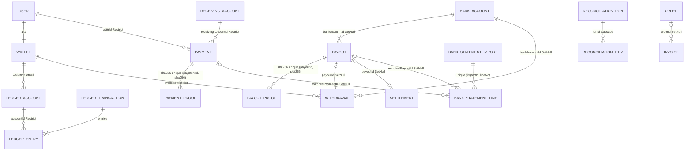

# CVC – ERD (khung)

Đây là khung dữ liệu. Mô hình chi tiết + migration được hiện thực từ Phase 2 trở đi; cập nhật file này khi thêm bảng.

## Quy ước chung

- Bảng số nhiều **snake_case** qua `@@map`; cột **camelCase** trong code qua `@map`.
- Khóa chính `id` (cuid/uuid). Thời gian `createdAt`, `updatedAt` (DateTime).
- **Tiền:** kiểu `Decimal`, luôn kèm cột `currency` (`VND`/`CNY`). Không dùng float.
- **Sổ cái kép:** `LedgerEntry` bất biến (không sửa/xóa; sai thì bút toán đảo). Mỗi giao dịch cân bằng nợ/có.
- Máy trạng thái lưu cột `status` + bảng sự kiện (`OrderEvent`, audit) ghi ai/khi nào/từ→sang/lý do.
- Phân quyền theo 7 vai trò; kiểm tra sở hữu bản ghi ở tầng service.

## Nhóm thực thể (dự kiến)

| Nhóm                  | Thực thể chính                                                                                                                                                                                                                                                                                                                 | Ghi chú                                                                                                                                                                                                                                                                                                                                                                                                                       |
| --------------------- | ------------------------------------------------------------------------------------------------------------------------------------------------------------------------------------------------------------------------------------------------------------------------------------------------------------------------------ | ----------------------------------------------------------------------------------------------------------------------------------------------------------------------------------------------------------------------------------------------------------------------------------------------------------------------------------------------------------------------------------------------------------------------------- |
| Người dùng & xác minh | `User`, `VerificationToken`, `Session`, `OtpRequest`, `RecoveryCode`, `UserRole`, `Profile`, `Address`, `BankAccount`, `KycSubmission`, `KycDocument`, `KycEvent`, `Organization`, `TotpSecret`                                                                                                                                | argon2id; token/OTP lưu băm SHA-256; OTP qua Gmail (không SMS, 2026-11-13); TOTP 2FA — secret mã hóa AES-256-GCM, tách bảng `totp_secrets` (2026-11-16); `user_roles` = nguồn thật RBAC, 7 vai trò + nhóm `admin_*` (2026-11-14); hồ sơ cá nhân/hộ KD/doanh nghiệp, số TK ngân hàng mã hóa AES-256-GCM + hiển thị che `****1234` (2026-11-14); eKYC duyệt tay (D13); `organizations` + BankAccount gắn được org (2026-11-16)  |
| Danh mục              | `Category`, `Product`, `ProductImage`, `ProductSpec`, `Supplier`, `SupplierAccount`, `SupplierProduct`, `PartnerBanner`                                                                                                                                                                                                        | `priceRef`, `costPrice` và thông tin supplier là nội bộ — không ra API công khai; Product soft delete; index `[categoryId, status]` (2026-11-16)                                                                                                                                                                                                                                                                              |
| Tìm nguồn             | `SourcingRequest`, `SourcingRequestAttachment`, `Quote`, `QuoteSelection`, `Order`, `OrderStageLog`, `OrderEvent`, `Sample`, `SampleStop`, `Shipment`, `ShipmentStop`, `Claim`, `ClaimProposal`, `ClaimResolution`, `ReturnShipment`, `Refund`, `DealRoom`, `DealRoomMember`, `Message`, `Translation`, `Offer`, `LockedTerms` | Không lộ giá mua/NCC ngoài Deal Room; Order **cấm xóa**, status = 10 trạng thái D7 + CANCELLED (P4.16 cài bảng chuyển), OrderStageLog/OrderEvent ghi vết; QuoteSelection 1 lựa chọn/RFQ, ClaimResolution 1 quyết định/claim; DealRoom 1-1 Order/RFQ, LockedTerms bất biến qua trigger DB (2026-11-16)                                                                                                                         |
| Mua hộ                | `Campaign`, `CampaignLine`, `CampaignStageLog`, `CampaignSurvey`, `CampaignRisk`, `Participation`, `ParticipationLine`, `GoodsRequest`, `ReturnRequest`                                                                                                                                                                        | Stage enum 7 bước (demo stage 0–6); tham số kinh tế theo D4 trên Campaign (rates Decimal(6,4), depositRate 0.30, returnAfterDays 45, returnBonusRate 0.03); **capacity enforce bằng trigger DB** trên participations (SUM(unitsBought) ≤ capacity, chặn INSERT + UPDATE) (2026-11-16)                                                                                                                                         |
| Bán giùm              | `ResaleListing`, `RetailerRegistration`, `Store`, `Allocation`, `AllocationLine`, `Transfer`, `TransferReceipt`                                                                                                                                                                                                                | Store soft delete (FK SetNull khi xóa cứng); Allocation từ GoodsRequest; Transfer between stores + receipt ảnh (2026-11-16)                                                                                                                                                                                                                                                                                                   |
| Bán hàng & kho        | `Sale`, `SaleLine`, `SaleImport`, `InventoryLot`, `InventoryMovement`, `InventoryBalance`, `StockCount`, `Inspection`, `InspectionPhoto`, `QcReport`, `QcChecklistTemplate`                                                                                                                                                    | **InventoryMovement append-only (trigger DB chặn UPDATE)**; tồn = SUM(quantity) + bảng tổng hợp InventoryBalance unique [lotId, storeId] cập nhật cùng transaction; SaleImport fileHash unique chống import trùng (2026-11-16)                                                                                                                                                                                                |
| Hợp đồng              | `ContractTemplate`, `Contract`, `ContractVersion`, `ContractParty`, `ContractSignature`                                                                                                                                                                                                                                        | Template unique [type, version]; ContractVersion append-only — sau `status=SIGNED` service không tạo version mới = nội dung không đổi được; bên ngoài không cần tài khoản (userId SetNull) (2026-11-16)                                                                                                                                                                                                                       |
| Thanh toán (thủ công) | `ReceivingAccount`, `Payment`, `PaymentProof`, `Payout`, `PayoutProof`, `BankStatementImport`, `BankStatementLine`, `Withdrawal`, `Settlement`, `ExchangeRate`                                                                                                                                                                 | P2P + ảnh minh chứng, duyệt 2 lớp trên ngưỡng (D13); Payment/Payout `paymentNo`/`payoutNo` unique; BankStatementImport **fileHash unique** chống import trùng sao kê; BankStatementLine match payment/payout (2026-11-18)                                                                                                                                                                                                     |
| Sổ cái & ví           | `Wallet`, `LedgerAccount`, `LedgerTransaction`, `LedgerEntry`, `ReconciliationRun`, `ReconciliationItem`                                                                                                                                                                                                                       | **LedgerEntry bất biến qua trigger DB** (UPDATE/DELETE chặn, SIGNAL LEDGER_ENTRY_IMMUTABLE; mở khóa bảo trì bằng session var `@cvc_ledger_unlocked`); **cân nợ/có enforce ở DB** qua `ledger_entries_balanced` (SUM debit = SUM credit khi đủ expectedEntries); CHECK amount > 0, balance ≥ 0; sai → bút toán đảo, không sửa (2026-11-18)                                                                                     |
| Vận chuyển (thủ công) | `Shipment`, `ShipmentStop` (đã hiện thực trong nhóm Tìm nguồn)                                                                                                                                                                                                                                                                 | Hãng/mã vận đơn/link tra cứu + mốc nhập tay (D13)                                                                                                                                                                                                                                                                                                                                                                             |
| Khiếu nại             | `Claim`, `ClaimProposal`, `ClaimResolution`, `ClaimEvent`, `ReturnShipment`, `Refund` (đã hiện thực trong nhóm Tìm nguồn)                                                                                                                                                                                                      | Máy trạng thái tường minh; Refund.paymentRef nối sang Payment (P3.9)                                                                                                                                                                                                                                                                                                                                                          |
| Hệ thống              | `AuditLog`, `Notification`, `NotificationPreference`, `Invoice`, `FileObject`, `IdempotencyKey`, `SystemSetting`, `SearchDocument`, `FundingApplication`, `CrmContact`, `CrmActivity`, `ShowroomVisit`, `Report`                                                                                                               | File riêng tư (KYC, minh chứng) tách bucket công khai; AuditLog append-only + hash chuỗi, Notification theo kênh + preference (2026-11-15); IdempotencyKey thêm `expiresAt` TTL 24h (2026-11-16); SystemSetting cấu hình runtime có version + audit; SearchDocument chỉ mục FULLTEXT dùng chung (2026-11-16); P3.10: FundingApplication (duyệt admin), CRM contacts/activities/visits, Report params/result Json (2026-11-18) |

## Quan hệ chính (phác thảo)

```
User 1─n VerificationToken (EMAIL_VERIFY | PASSWORD_RESET, token băm, một lần, có hạn)
User 1─n Session (refresh token băm; familyId = chuỗi xoay vòng, dùng lại token cũ → thu hồi cả chuỗi; activeRole = vai trò đang dùng, P2.9)
User 1─n UserRole (RBAC: 7 vai trò buyer/participant/retailer/supplier/sales/inspector/admin; nhóm admin thêm dạng admin_super/admin_finance/admin_ops/admin_support — P2.7/P2.9/P2.10)
OtpRequest (theo email; mã 6 số băm, hạn 5 phút, đếm số lần thử) — OTP đăng nhập qua Gmail, không phải SMS
User 1─n RecoveryCode (mã dự phòng 2FA, băm SHA-256, dùng đúng một lần; User 1─1 TotpSecret — secret mã hóa AES-256-GCM trong bảng riêng `totp_secrets`, enabledAt null = đang cấu hình; admin/sales/inspector bắt buộc bật 2FA)
User 1─n Organization (ownerId Restrict, soft delete) n─n… BankAccount (userId nullable + organizationId nullable — ít nhất một chủ sở hữu, enforce service layer vì MySQL cấm CHECK trên cột FK có referential action)
Category self-FK n─1 (cây SetNull, slug unique, soft delete) 1─n Product (sku unique `CVC-…`, priceRef/costPrice nội bộ, index [categoryId, status]) 1─n ProductImage (fileObjectId SetNull) / ProductSpec (unique [productId, key])
Supplier 1─n SupplierAccount (user 1─1, status ACTIVE/SUSPENDED — khóa thì chặn đăng nhập + thu hồi phiên) 1─n SupplierProduct n─1 Product (unique [supplierId, productId], approvedAt = admin duyệt trước khi publish, sku NCC-…) — giá mua/costPrice không ra API công khai
PartnerBanner (partnerType SUPPLIER/SHIPPING, position enum, isActive + startsAt/endsAt, logoFile SetNull, index [position, isActive]) — API công khai chỉ trả banner đang trong cửa sổ hiệu lực (hết hạn tự ẩn)
SourcingRequest (requestNo `CVC-RFQ-…`, buyerId Restrict, soft delete, status OPEN/QUOTED/SELECTED/CONVERTED/EXPIRED/CLOSED/CANCELLED — hết hạn tự chuyển EXPIRED thì không nhận/chọn báo giá; market + targetPrice cho khách; assignedTo SetNull + slaDueAt/slaRemindedAt nội bộ, index [assignedToId, status]/[slaDueAt]) 1─n SourcingRequestAttachment (fileObjectId SetNull) / 1─n SourcingRequestNote (ghi chú nội bộ, author Restrict, cascade theo request — không trả ra API khách) / 1─n Quote (supplierId Restrict, unitPrice Decimal + currency, validUntil, status SUBMITTED/SELECTED/REJECTED/EXPIRED) / 1─1 QuoteSelection (requestId unique + quoteId unique, decidedBy FK)
SourcingRequest 1─n Order (orderNo `CVC-ORD-…`, buyerId + supplierId Restrict, cấm xóa, status 10 trạng thái D7 + CANCELLED, stageIndex, totalAmount/depositAmount Decimal(18,2) + currency) 1─n OrderStageLog (stageIndex + status + actor) / OrderEvent (type, data Json)
Order 1─1 DealRoom (hoặc SourcingRequest 1─1 DealRoom trước khi thành đơn) 1─n DealRoomMember (unique [roomId, userId]) / Message (type TEXT/SYSTEM/OFFER, sender SetNull) 1─n MessageAttachment / Translation (unique [messageId, lang])
DealRoom 1─n Offer (unitPrice + quantity + conditions, status PENDING→ACCEPTED/REJECTED/COUNTERED/WITHDRAWN)
Order 1─1 LockedTerms (terms Json snapshot, version, lockedBy) — trigger DB chặn UPDATE, bất biến sau khóa
ContractTemplate (unique [type, version]) 1─n Contract (ownerType/ownerId lỏng đa hình, templateVersion, status DRAFT→SIGNED…) 1─n ContractVersion (append-only, unique [contractId, version]) / ContractParty (unique [contractId, role]) 1─1 ContractSignature (unique [contractId, partyId], method/providerRef)
Campaign (stage 7 bước, tham số D4: costPrice/retailPrice/rates/depositRate 0.30/returnAfterDays 45/returnBonusRate 0.03) 1─n CampaignLine (unique [campaignId, productId]) / CampaignStageLog / CampaignSurvey / CampaignRisk
Campaign 1─n Participation (unique [campaignId, userId], unitsBought Int) — trigger DB: SUM(unitsBought) ≤ capacity, chặn INSERT + UPDATE vượt (CAPACITY_EXCEEDED)
Store (soft delete) 1─n GoodsRequest n─1 Campaign; GoodsRequest 1─n Allocation (status ALLOCATED→IN_TRANSIT→RECEIVED) 1─n AllocationLine
Store n─n qua Transfer (from/to, status IN_TRANSIT→RECEIVED) 1─n TransferReceipt (file SetNull)
ResaleListing (productId Restrict, salePrice + retailerShareAmount, quantityRemaining, isActive + soft delete)
Sale (storeId Restrict, index [storeId, soldAt]) 1─n SaleLine; SaleImport (fileHash unique = chống import trùng)
InventoryLot 1─n InventoryMovement (append-only, quantity có dấu, storeId null = trung tâm; trigger DB chặn UPDATE) — tồn = SUM(quantity); InventoryBalance (unique [lotId, storeId], "" = trung tâm) upsert cùng transaction
InventoryLot 1─n StockCount / Inspection (result PASSED/PARTIAL/FAILED) 1─n InspectionPhoto / QcReport (orderId/lotId SetNull, passed, items Json); QcChecklistTemplate (items Json)
Order 1─n Sample (sampleNo `CVC-SMP-…`, status REQUESTED→…→APPROVED/REJECTED/STOPPED) 1─n SampleStop (reason)
Order 1─n Shipment (carrier/trackingNo nhập tay, trackingUrl, proofFile SetNull, status PREPARING/IN_TRANSIT/DELIVERED/RETURNED) 1─n ShipmentStop (occurredAt, description, enteredBy FK)
Order 1─n Claim (claimNo `CVC-CLM-…`, type QUALITY/DAMAGED/MISSING/WRONG_ITEM/OTHER, filedBy FK) 1─n ClaimProposal (kind REFUND/PARTIAL_REFUND/RETURN/REPLACE/COMPENSATE, amount?, status PENDING/ACCEPTED/REJECTED/COUNTERED/WITHDRAWN) / 1─1 ClaimResolution (decision, decidedBy) / 1─n ReturnShipment (direction RETURN_TO_SUPPLIER/REPLACEMENT_TO_BUYER) / 1─n Refund (method BANK_TRANSFER/WALLET, status, paymentRef loose chờ P3.9, bankAccountId SetNull)
User 1─1 Profile (orgType PERSONAL/BUSINESS_HOUSEHOLD/COMPANY; displayName; MST unique, ĐKKD, người đại diện — P2.11)
User 1─n Address (label, người nhận, SĐT, city/district/ward/line, isDefault — P2.11)
User 1─n BankAccount (bankName, holderName phải khớp tên hồ sơ; accountNoEnc mã hóa AES-256-GCM + accountNoLast4 hiển thị + accountNoHash SHA-256 unique — P2.11)
User 1─n KycSubmission (status PENDING/NEED_MORE/APPROVED/REJECTED; reviewedBy/reviewedAt/reviewNote) 1─n KycDocument (type CCCD_FRONT/CCCD_BACK/BUSINESS_REG/AUTHORIZATION; mime/size/s3Key/bucket — file nằm bucket riêng tư, chỉ chủ sở hữu + admin KYC tải link có hạn 5 phút, log truy cập) — P2.12
KycSubmission 1─n KycEvent (SUBMITTED/DOCUMENT_UPLOADED/APPROVED/NEED_MORE/REJECTED/DOCUMENT_ACCESSED — lịch sử duyệt + log truy cập, P2.13)
AuditLog (append-only, không update/delete API; hash chuỗi SHA-256 mỗi dòng chứa hash dòng trước — verifyChain phát hiện can thiệp; AuditInterceptor tự log mọi write + log tay cho phân quyền/KYC/file; GET /admin/audit-logs + /verify chỉ admin) — P2.16
FileObject (ownerType/ownerId tham chiếu lỏng không FK; purpose kyc/payment_proof/shipping_proof/general; declaredMime + detectedMime magic bytes; status UPLOADING/READY/REJECTED; scanStatus NOT_SCANNED/PENDING/CLEAN/INFECTED/ERROR — chưa CLEAN không cho tải; presigned PUT/GET bucket riêng tư; thumbnail WebP 320px — P2.17; từ P3 các bảng domain (ProductImage, PartnerBanner, Shipment…) giữ FK cứng tới files với onDelete SetNull)
User 1─n Notification (event, title, body, data, readAt) 1─1 NotificationPreference (email/inApp/sms/zns/push; event bắt buộc bảo mật/tiền bỏ qua opt-out) — P2.18
IdempotencyKey (key = sha256(path|Idempotency-Key header), scope, requestHash, response {status, body}, expiresAt = createdAt + 24h; interceptor toàn cục cho POST có header; cùng key khác body → 422, lặp → trả lại kết quả đã lưu, lỗi → xóa slot; index expiresAt) — P2.21
SystemSetting (key VarChar(100) PK, value Json, version tăng khi ghi, updatedById; registry zod từng khóa, cache Redis TTL 30s tự hủy khi ghi; lịch sử đọc từ AuditLog entityType system_setting) — P2.22
SearchDocument (entityType + entityId unique, title, searchText chuẩn hóa bỏ dấu/đ→d + FULLTEXT ngram index thêm bằng raw SQL, data Json, status published/unpublished; các module domain tự upsert/remove khi bảng của chúng ra đời P3+) — P2.23
User 1─n Participation n─1 CampaignLot n─1 Campaign
User 1─n ConsignmentItem n─1 Consignment
DealRoom 1─n DealMessage / Quote / Sample
Payment 1─n PaymentProof      Payout 1─n PayoutProof
LedgerEntry n─1 Wallet        Shipment 1─n ShipmentStop
```

## Sơ đồ nhóm tiền & sổ cái (P3.9, hiện thực)



Quy tắc tiền (P3.9 — DoD Gate A):

- **Bất biến sổ cái ở tầng DB**: trigger `ledger_entries_no_update` / `ledger_entries_no_delete` SIGNAL `LEDGER_ENTRY_IMMUTABLE`. Nhân viên bảo trì phải mở khóa trong cùng interactive transaction: `SET @cvc_ledger_unlocked = 1` (test kiểm chứng cả chặn lẫn mở khóa).
- **Cân đối kép ở tầng DB**: trigger `ledger_entries_balanced` (AFTER INSERT) — khi `COUNT(entries) >= ledger_transactions.expectedEntries` thì `SUM(DEBIT) = SUM(CREDIT)`, ngược lại SIGNAL `LEDGER_UNBALANCED` (toàn bộ INSERT bị rollback).
- Sửa sai trong sổ = **bút toán đảo** (transaction mới, không đụng row cũ); `Wallet.balance` CHECK ≥ 0 + `LedgerEntry.amount` CHECK > 0.
- **Tiền duyệt 2 lớp (D13)**: user nộp ảnh minh chứng (`PaymentProof.sha256` unique per payment chống dùng lại ảnh) → admin đối chiếu `BankStatementLine` (từ import sao kê, `fileHash` unique chống import trùng) → `Payment.status = CONFIRMED` + ghi bút toán `LedgerTransaction`. `payments.amount`/`payouts.amount`/`withdrawals.amount` CHECK > 0.
- FK dữ liệu tiền `Restrict` (payment→user/receivingAccount, ledger entry→account, withdrawal→wallet); con trỏ người duyệt `SetNull`.

Quy tắc khác (P3.10): `FundingApplication` duyệt admin (reviewedBy SetNull); `CrmContact` soft delete — activities/visits Cascade; `SystemSetting` đã có từ P2 (version + audit); mẫu thông báo không có bảng riêng — template nằm ở code registry Notification (P2.18), không cần seed bảng.

> Sơ đồ chi tiết (cột, khóa ngoại, chỉ mục) sẽ bổ sung khi từng module được port từ demo sang Prisma. Nhóm tiền & sổ cái đã có sơ đồ mermaid ở trên; các nhóm còn lại giữ dạng phác thảo văn bản vì Prisma schema là nguồn thật (`apps/api/prisma/schema.prisma`).

## Seed (P3.12)

- **Dev/staging** (`pnpm exec prisma db seed`, tự chạy sau `migrate reset`): dataset demo port từ `legacy/cvc-demo/Ma-nguon/dist/domain.js` — 9 danh mục, 30 sản phẩm (`CVC-001…030`, giá CNY + spec + MOQ + lead), 18 NCC (+ SupplierProduct costPrice CNY), 20 cửa hàng (ST01–ST20), 3 campaign (CP01 REGISTRATION + CP02/CP03 DONE với đủ tham số D4), 2 participation COMPLETED, 4 allocation RECEIVED, 4 sale + 8 InventoryMovement + 4 InventoryBalance, 4 ResaleListing, 6 user demo (mật khẩu dev `Dev@123456`, argon2id). **Idempotent** — upsert theo unique key, chạy lại không sinh bản ghi trùng.
- **Production** (`NODE_ENV=production`): chỉ admin `admin@cvc.dev` + roles `admin`/`admin_super` + 6 SystemSetting (fx/deposit/return/horizon/lead) + ExchangeRate CNY→VND — không có dữ liệu demo.
- **Reset dev**: `pnpm --filter api prisma:reset` (`scripts/prisma-reset.mjs`, chặn khi production) → `prisma migrate reset --force` (xóa + migrate + seed).
